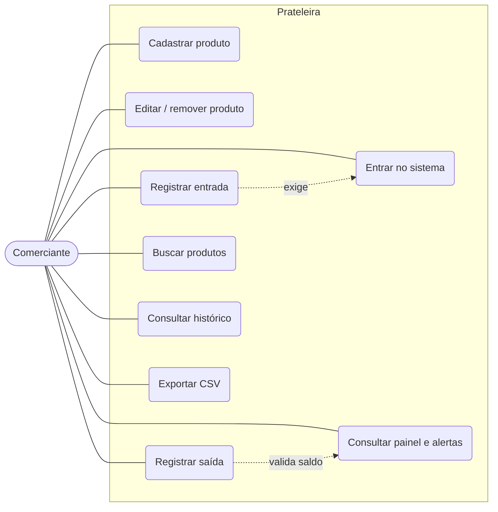
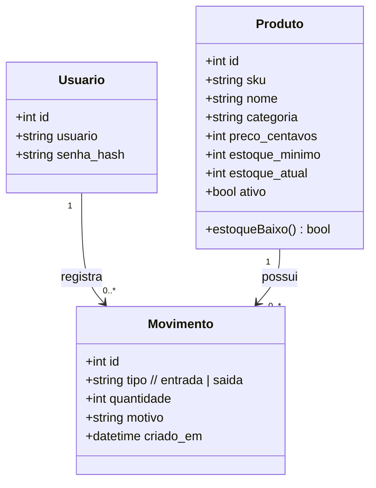
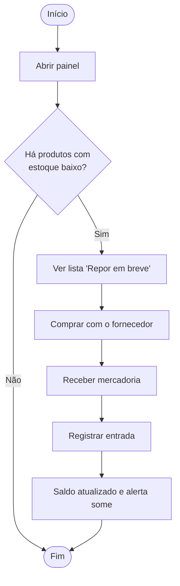
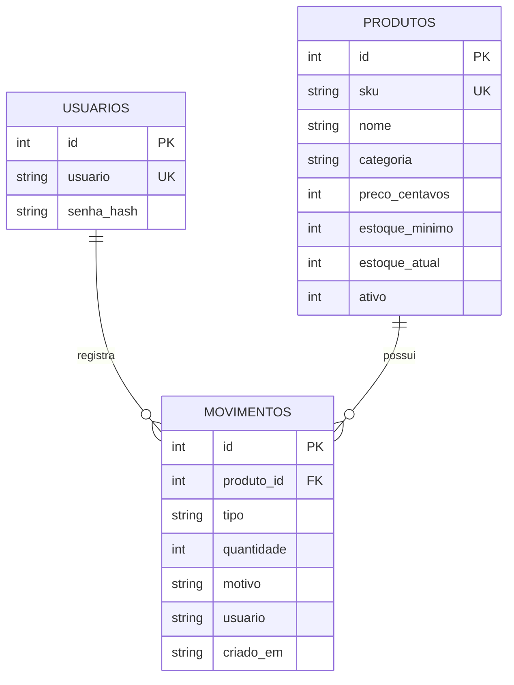

# 2. Diagramas UML

## 2.1 Casos de uso


## 2.2 Classes (modelo de domínio)


## 2.3 Sequência — registrar saída de estoque
```mermaid
sequenceDiagram
    actor C as Comerciante
    participant UI as Tela Produtos
    participant A as Flask (movimentar)
    participant DB as SQLite
    C->>UI: informa quantidade e clica em "Saída"
    UI->>A: POST /produtos/{id}/movimentar
    A->>A: valida sessão e quantidade > 0
    A->>DB: BEGIN IMMEDIATE; lê produto
    DB-->>A: estoque_atual
    alt estoque_atual - quantidade < 0
        A->>DB: ROLLBACK
        A-->>UI: aviso "Saída maior que o estoque"
    else saldo suficiente
        A->>DB: UPDATE produtos (novo saldo)
        A->>DB: INSERT movimentos
        A->>DB: COMMIT
        A-->>UI: aviso "Saída registrada. Estoque agora: N"
    end
```

## 2.4 Atividade — ciclo de reposição


## 2.5 Modelo de dados (ER)

